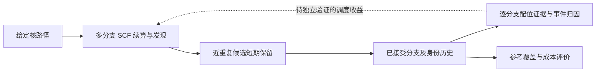

# 从 Phase 3b 到首篇论文：逻辑、证据与剩余工作

日期：2026-10-29。性质：基于现有记录、源码与本地结果的论文准备度审查；下列论文范围和工作包是建议，未替代用户已确定的路线，也不构成新增计算预算授权。

## 1. 当前判断

**Phase 3b 已完成现有开发基准的覆盖验收，可以开始组织方法与结果；首篇论文仍缺留出验证、可信的参考态集合、同预算对照和一个有解释力的化学应用。**

现有路线仍为：Phase 3b → 固定路径上的配位/电子态联合跟踪 → heme 多态 → QM/MM → 核空间耦合。首篇若采用固定 QM、给定核路径的范围，可在前两段形成闭环，无需等待整个 QM/MM 框架完成。

核查范围：两份 10 月 29 日验收/成本报告、`state.md` §4.9、§4.24–4.29、交接记录、路线与 Stateweaver 设计，及 `beam.py`、`beamrules.py`、`bench_beam.py`、`md.py`、`proto_ref3.py`。本轮直接解析了本地筛选关闭的四份完整 JSON 和退出码，并重算离线筛选审计；G1/G2 筛选开启结果及 E8 依据已落盘报告，未重新读取另一台机器上的原始结果。本轮没有运行 SCF、提交作业或重新跑测试。

## 2. 方法逻辑应如何串起来

### 2.1 问题与方法之间的因果关系

1. **单步收敛不能判断是否找到目标解。** 单条 IMOM continuation 可以平滑地跟随较高能分支；局部 overlap 很高也不能发现别处的更低解。
2. **每步独立搜索会丢失路径历史。** 有些分支从当前几何的常用初猜难以重新找到，却可从前一帧连续跟住。因此需要同时保存多个解的历史、身份和恢复种子。
3. **单几何的近重复判定存在歧义。** B/B′ 在起点 σ≈0.992、ΔE≈0.003 mHa，后来成为不同的分支。立即去重会丢掉以后有用的信息。
4. **暂缓去重决定，再观察几步。** 有限寿命的 shadow 保留近重复候选；分开后进入正式 beam，同一化后丢弃。E8 已给出一组受控的机制证据。
5. **可靠性必须与计算预算一起评价。** 加密发现、unknown 升级、pending 续算、筛选与并行各有代价；需要展示漏态率与总成本之间的关系。
6. **沿各分支解释配位变化。** 描述符必须按 lineage 保存，才能区分同一分支内的结构变化与选中分支改变造成的跳变。配位信号能否改善调度，仍需实验。

术语边界：当前对象是指定泛函、基组和自旋投影扇区下的 SCF 驻点/解分支；不能直接把每条 lineage 当作精确多电子本征态。`adiabatic_min` 是已找到候选中的最低者。现有回放不证明全局基态覆盖、真实自旋跃迁或非绝热动力学。

### 2.2 现有方法与潜在贡献

外推、MOM/IMOM、多初猜、多解搜索均有先例。尤其 [Vaucher–Reiher 2017](https://arxiv.org/abs/1701.00128) 已针对结构序列，用随机轨道扰动检测并纠正不希望的 SCF 收敛；[Thom–Head-Gordon 2008](https://pubmed.ncbi.nlm.nih.gov/19113263/) 已用 SCF metadynamics 搜索多个解。不能仅用“自动找更低解”作为创新表述。

本项目值得检验的贡献组合是：**跨几何持续管理多个分支，保留暂时无法区分的候选，记录恢复与选态过程，并将配位事件归因到分支历史。** 其中 shadow 的延迟判别最有机制故事，Stateweaver 的事件归因可提供化学意义。上述判断是有限文献核查后的研究定位，尚未完成系统新颖性审查，也不能据此声称首次。

## 3. 已有证据可以支撑到哪里

| 证据 | 已有结果 | 可以支持的结论 | 尚不能支持的结论 |
|---|---|---|---|
| G1 对称起点 | 11 步×4；R1″与影子开启复核均通过 | 本开发路径的对称破缺问题得到控制 | 任意金属配合物、任意取向均可靠 |
| G2 traj2 | 60 步×4，0 miss/0 warn；标准未放宽 | 相对 ref3 的开发基准覆盖通过 | 独立化学体系的泛化、全部低能态召回 |
| E8 注入同一批起点候选 | 关影子复现第5步 WARN；开影子第4步晋升 B，第5步选中 B | 一组受控反例证明影子能救回特定分支 | 影子参数、寿命和容量的普适性 |
| 筛选关闭对照 | 本轮核对：4份各60步，顺序完整，全部0 miss/0 warn | 两组配置在该路径上均通过 | 同输入下逐候选输出完全等价 |
| 离线筛选审计 | 本轮重算：1300候选，拟丢593，已收敛窗口内反例0；省47280/82599≈57%枚举候选周期 | 该样本内的筛除收益与已收敛候选风险 | 未收敛候选最终不会成为低能解；其他体系同样安全 |
| 成本报告 | G2每条约2.93–3.64 h/10核；搜索仍占大头 | 当前配置可运行，成本来源可解释 | 跨硬件墙钟加速比、相对强基线的整体优越性 |
| Stateweaver | 已有研究设计；未见新增实现与验证产物 | 后续工作有清晰问题定义 | 已证明配位监测或调度增益 |

G2追加×5的本地输出本轮只保存到 t0–t4 的第4/5/7/5/4步，退出码文件为空；已有行均无 miss/warn。它们是部分记录，完成情况未知，不能计入通过次数。未查询远端调度器。t1 起点存在不同于常见 B 的候选，但仅凭与 A 的 overlap 不能认定它就是 B′，需用已存轨道和 shadow ID 跟踪。

四次回放是对同一核路径的重复初始化/数值运行，不是四条独立化学路径；71个几何也不能当作71个独立统计样本。现有测试和回放通过应分别报告，不能用测试数量代替科学验证。

## 4. 距离可投稿还缺的硬证据

### 4.1 参考答案与指标

`proto_ref3.py` 与待测实现共享后端、占据枚举和 σ=0.9 的去重思想，参考也曾在分段起点漏态。因此 ref3 应称为“指定方法/搜索范围内的最佳已知参考”，不能称穷举真值。

ref3 保存全部已找到态的能量，但只保存最低者的轨道。当前 `judge_step` 对照的是选中解与最低参考解；这不足以计算整个窗口的逐态 recall。论文若主张“多态覆盖”，必须保存参考窗口内全部解的轨道、密度或足以重建的身份信息，并另行审查近重复去重。

最低限度的补法：在冻结留出几何上组合更丰富初猜、独立随机扰动、正反向 continuation 和更紧收敛；对仍有歧义的点增加搜索直至明确剩余不确定性。保存参考方法、搜索预算、所有低能解与失败尝试。SCF稳定性检查能识别驻点的性质，但不能单独证明全局最低；[Q-Chem官方文档](https://manual.q-chem.com/7.0/sub_stability_analysis.html) 给出了轨道Hessian稳定性与自动纠正的相关方法。目标是跟踪激发驻点时，应报告其稳定性分类，不能把所有非极小驻点机械删除。

最低能态遗漏、带符号能量差、身份匹配、静默换根、恢复延迟、未解决比例和成本需分别输出。当前 `de_mha` 使用 selected−min(selected,reference)，会把“算法比参考更低”截成0；论文分析须保留原始 signed ΔE，触发参考复核。

### 4.2 留出与迁移

现有两条 FeII 路径已反复用于设计和调参，属于开发集。`densify_random=40`、`shadow_sv=0.999`、`shadow_steps=5` 和筛选 margin 只在本体系校准；其中若干参数仍是代理建议，不是普适结论。

论文验证应在计算前冻结：体系与路径清单、开发/留出划分、参数、参考构造、比较预算与失败计分规则。建议至少增加不同扰动/步长的独立路径，以及一类未参与调参的配位环境或小配合物。具体数量由预实验成本与失败分布决定。留出结果不理想时，保留失败；改参后须另设留出数据。

另需检查：影子超过寿命、不收敛、同一 keeper 存在多个真正不同的近重复候选、beam容量受限、两种晋升路径（overlap分开/能量分开）、unknown持续存在。当前“每个keeper只留一个影子”本身可能漏掉其余分支。

### 4.3 同预算对照与消融

建议对照组：单条read/IMOM；单条加定期独立搜索；多分支加定期搜索；多分支加电子alarm调度；完整配置。至少加入一种接近 Vaucher–Reiher 的随机扰动搜索基线，或在论文中明确解释未比较的原因与主张限制。

先固定物理方法、候选定义和容差，再比较相同总SCF预算下的漏态，及相同覆盖要求下的总成本。初始化、失败、恢复、shadow、梯度和I/O都要计入。消融重点是shadow、对称破缺发现、unknown升级/续算；筛选对照已有开发集证据，留出上仍需验证。

受控机制实验使用相同已保存输入；端到端实验保留自然搜索随机性，按独立路径/初态报告重复与区间。墙钟比较使用同硬件与资源配置，同时报告总周期、P50/P95和worker内存。搜索周期下降57%不能写成全流程墙钟提速57%。

### 4.4 一个能说明价值的化学问题

沿既定路线，先做固定QM的Fe–O拉远/返回，再做一个完整QM配体交换模型。先建立只读观察器，在相同已保存分支帧上比较距离规则、键级规则、联合规则与逐lineage归因；随后才独立研究调度。

最有价值的结果是展示：最低解串联造成的配位描述符跳变，与同一分支上的连续配位变化，确实会导致不同解释；逐分支历史能减少误归因。人为路径仅用于构造压力测试；若主张反应机制或解离能，需要相应路径优化与独立电子结构验证。

事件驱动调度须对照电子alarm与固定周期搜索，在同预算下给出增益。如果没有增益，收缩调度主张；监测和归因是否足以独立成文，仍取决于对照效果与新颖性，不能自动视为成功。

### 4.5 力与动力学主张的附加门

固定路径电子态论文可以不以完整MD为主结果。若保留“可用force engine”的主张，至少补同一分支上tight-SCF力对照与固定分支有限差分一致性，并单列切换处。当前 `BeamResult` 与 `md.py` 的 `_record` 在 `scf_iterations` 和status类型上不直接兼容，尚需适配。

最低包络切换处可有cusp；不能把正常切换与SCF力错误混在一个NVE漂移指标中。真正声称QM/MM还需要MM侧力、embedding与边界的一致能量验证。首篇范围建议不依赖这些扩展。

## 5. 论文范围与分阶段工作

推荐工作标题方向：**Stateful tracking of competing SCF solutions and coordination events along molecular paths**。标题和摘要按实际结果再定；目前没有完成QM/MM或新的降阶理论证据。

| 阶段 | 具体产物 | 进入下一段的门 |
|---|---|---|
| P0：证据冻结 | 归档已有结果与脚本、源码/输入hash、参数与环境清单；判读追加×5；冻结首篇范围和留出协议 | 能从文件重建每项现有结论；未完成项明确；协议确认后再释放新计算预算 |
| P1：可靠性验证 | 加强参考、保存全态身份、独立留出路径、强基线与shadow机制消融 | 留出上存在可解释且稳定的覆盖收益；失败不能靠事后放宽判据消失 |
| P2：Stateweaver观察器与应用 | 固定QM解离/返回与交换；逐分支事件记录；监测基线 | 相对只串联最低解，事件归因有可复核价值；标签参考独立于待测阈值 |
| P3：调度与效率 | 相同预算调度对照、覆盖—成本曲线、总资源计量 | 有收益则保留调度贡献；无收益如实收缩并重新评估论文力度 |
| P4：稿件与复现 | 方法伪代码、完整图表、失败边界、数据清单与可运行最小例 | 所有摘要主张逐项指向证据，不依赖聊天记录或未提交工作区 |

建议正文主图：方法/生命周期；B/B′的受控机制；留出路径覆盖—成本；配位变化与选态切换的归因；调度对照或明确的适用边界。早期失败历程可整理到补充材料，正文按科学问题组织。

**距离判断：**现有工作足以支撑方法部分和开发基准案例，但支撑论文主结论的P1、P2尚未完成，P3也尚无结果。剩余主体是一轮冻结的系统验证和一个配位化学应用。现在可以开始论文骨架，尚不宜把现有验收报告直接改成投稿稿件。

资源持续可用、留出验证无需重设方法、观察器实现顺利时，可用“约1周冻结/参考准备 + 1–2周留出与对照 + 2–3周观察器/应用 + 1–2周整稿”作粗略排期，即约5–8个有效工作周到首版完整稿；这是建议性估计，不是已测算的CPU预算或工期承诺。若出现新的分支失效或需要高等级参考，周期需重估。完整heme多自旋、蛋白QM/MM与核空间耦合应另行排期。

## 6. 立即优先级

先完成P0：整理追加×5的已有输出与完成状态、固定可复现源码和输入、写出首篇冻结协议。其后沿既定路线做只读的配位观察器和独立留出验证。当前没有证据要求为了首篇论文先加搜索冷却、更多并行优化、XL-BOMD、ORCA或蛋白体系；这些不应挤占上述科学证据工作。
