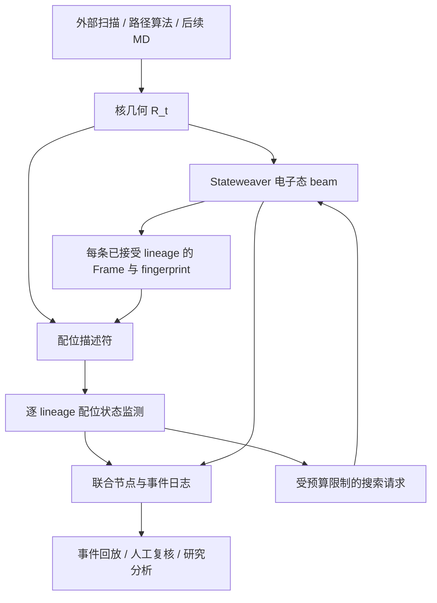

# Stateweaver：配位事件与电子态联合跟踪的设计研究思路

日期：2026-10-03。状态：研究与工程设计，尚未实现本文新增模块，尚无新增科学验证结果。

本文以当前工作区的 `sroqm` 实现为依据；工作区包含未提交改动，因此这里的实现状态不等同于对远端 `main` 的审计。Stateweaver 是本文使用的研究框架名称，现有 Python 包名仍为 `sroqm`。

## 1. 研究目标与第一篇工作的边界

研究目标是建立一个能够沿核坐标路径，同时记录金属中心配位变化和电子态演化的有状态框架。对 Fe–X 解离、配体进入以及配体交换，系统应能回答：

1. 哪个原子对的成键特征正在减弱或增强？在哪个路径区间形成了可信的配位状态变化？
2. 这件事发生在哪条电子态 lineage 上？是否伴随电荷转移、局域自旋重排或最低能电子态切换？
3. 当前观察是否足以确认事件，还是受到 SCF 未收敛、态丢失或描述符冲突的影响？
4. 这些配位信号能否帮助分配电子态搜索预算，在相同计算成本下减少漏态？

第一阶段采用固定 QM 原子集合，把 Fe、原配体和候选新配体全部纳入 QM。核路径来自人为扫描或外部路径算法。交付目标是“在给定路径上识别并解释事件”，自主发现反应路径、跨自旋动力学和自适应 QM 分区属于后续工作。

建议的首篇方法学主题：

> **金属配位变化过程中，电子态 lineage 与配位事件的联合跟踪，以及事件驱动的电子态搜索。**

单独增加 Mayer 键级和距离阈值不足以构成明确的方法创新。潜在贡献是：按电子态保存配位历史、区分结构变化与选态切换、显式记录不确定性，并验证这些信息能否提高固定预算下的搜索可靠性。这仍是待检验的研究假设；本文不是完整的优先权或新颖性审查。

## 2. 现有基础与新增能力

| 能力 | 当前工作区依据 | 本研究中的处理 |
| --- | --- | --- |
| SCF continuation、占据空间 overlap | `engine.py`、`overlap.py`、`imom.py` | 复用 |
| 密度矩阵、轨道、AO overlap | `frame.py:Frame` | 作为键级输入 |
| 局域电荷、自旋、S² | `fingerprint.py`、`engine.py:Result` | 复用；逐原子分析需保证 fragment 定义匹配 |
| 多个低能 SCF 解及 lineage 管理 | `beam.py`、`search.py` | 在固定总自旋投影扇区内复用 |
| 不同总自旋扇区搜索 | 当前 `Engine` 沿用 `template.spin` | 单独扩展，不能当作现有能力 |
| Fe–X 键级、配位状态、事件历史 | 未见相应实现 | 本研究第一阶段新增 |
| 自适应 QM 区、分区变化后的态映射 | 未实现 | 后续独立课题 |
| 完整 QM/MM 动力学耦合 | README 将 MM 端梯度/OpenMM 耦合列为未开始 | 首阶段避免依赖此项 |

PySCF 的 QM 计算不需要预先固定 QM 内部的化学键拓扑，因此在模型允许的情况下能够描述成键特征随几何变化。但这不保证单参考 HF/DFT 正确给出强关联解离的能量、产物电荷或自旋排序。必须分开评价“事件监测可靠性”和“电子结构方法的物理准确性”。

## 3. 三个可检验的研究假设

### H1：几何与电子描述符联合使用，能减少配位事件误判

对相同轨迹，比较距离阈值、键级阈值以及二者结合并带滞回的规则。重点观察热振动、近距离弱相互作用、电子态切换和描述符冲突区间。

成立条件：冻结参数后，联合规则在保留事件检出能力的同时减少误报与标签抖动，并且在留出路径上仍成立。若提高 precision 只是通过把大量帧标成不确定来实现，需同时报告覆盖率，不能只报告 precision。

### H2：每条电子态独立保存配位历史，能避免选态切换造成的错误归因

同一几何可能存在多个 SCF 解，不同解可具有不同成键特征。把每一步最低能解串起来，键级跳变可能来自所选电子态变化。

成立条件：逐 lineage 记录能明确区分“同一态上随几何的变化”和“切换电子态后的成键特征差异”；合成切换回放和实际多态路径都能保留这一归因。电子态改变造成的成键重排也有物理意义，应记录为电子来源的事件，而不是简单丢弃。

### H3：配位事件能为电子态搜索提供额外信息

配位弱化、形成或描述符冲突可能发生在已有电子 alarm 尚未触发的区间。可测试这些信号能否提前启动一次受预算限制的搜索。

成立条件：与只使用现有电子 alarm 的调度相比，在相同总计算预算下，漏掉参考低能态的比例下降；或达到相同漏态水平时成本下降。若无增益，应保留监测层作为解释工具，并收缩“加速搜索”的论文主张。

## 4. 架构：联合观察，而不是枚举整个图乘积



概念上写成：

\[
\mathcal G_{\mathrm{joint}}
\subseteq
\mathcal G_{\mathrm{electronic}}\times\mathcal G_{\mathrm{coordination}}.
\]

实现只保存实际观察到的联合节点与转移。节点至少包含：体系与分区标识、几何帧标识、电子 lineage ID、配位图标签和证据质量。配位图是分析标签，不直接修改 Hamiltonian 或 MM 键拓扑。

同一几何下的态间差异属于“同几何电子态比较”；相邻几何上的跟踪属于“路径转移”。两种边必须分开。事件日志不能直接推导反应速率、非绝热跃迁概率或热力学状态网络。

## 5. 第一版描述符

### 5.1 候选原子对

首版由用户显式指定金属和候选供体原子，固定配对列表。Fe–O、Fe–N、Fe–S 分别配置校准参数。完整反应参与者始终在 QM 区，不因一时远离金属而删除。

后续可按距离构造候选邻居，但候选筛选半径只决定分析对象，不能等同于成键阈值；离开筛选半径也不能自动作为断键证据。原子身份使用稳定的全局 ID，不能只依赖局部 QM 索引。

### 5.2 连续证据向量

对每个原子对 A–B、每条电子 lineage l：

\[
\mathbf d_{AB}^{(l)}(t)=
\big(r_{AB},M_{AB}^{(l)},q_A^{(l)},q_B^{(l)},
       m_A^{(l)},m_B^{(l)}\big).
\]

其中 r 使用 Å 输出；引擎输入继续使用 Bohr。q 为选定人口分析下的原子电荷，m 为带符号的自旋人口，不是原子的量子数 S。记录人口分析方法及 fragment 定义；不混用 Mulliken、meta-Löwdin 等结果的阈值。

第一版保留完整向量，不先压成一个所谓“成键概率”。电荷与自旋主要解释成键变化的电子背景，不强制要求所有断键都出现电荷或自旋跳变，也不凭原子电荷直接赋值 FeII/FeIII。

### 5.3 开壳层 Mayer 键级

首版限定实数 AO 表示的 RHF/RKS/UHF/UKS，并明确约定：

\[
P=D^\alpha+D^\beta,\qquad W=D^\alpha-D^\beta,
\]

\[
M_{AB}=\sum_{\mu\in A}\sum_{\nu\in B}
\left[(PS)_{\mu\nu}(PS)_{\nu\mu}
     +(WS)_{\mu\nu}(WS)_{\nu\mu}\right].
\]

闭壳层时 W=0，P 使用总密度矩阵。UHF/UKS 使用自旋分辨密度，不把闭壳层表达式未经检验地直接套到开壳层。

Mayer 键级已有成熟定义，不能作为本工作的算法发明。公式与实现需对照原始文献及独立软件核验。[Mayer 1983](https://doi.org/10.1016/0009-2614(83)80005-0)、[Mayer 1986](https://doi.org/10.1002/qua.560290320)、[HONDO 官方手册](https://comp.chem.umn.edu/hondoplus/HONDOPLUS_Manual_v5.2.2013.1.20_160412fix.pdf)

Mayer 键级不保证落在 [0,1]，不能裁剪后当作概率。保存原始值、方法、基组和自旋扇区。负值或异常大值先标记为需要复核，不能静默改写。由 AO 索引分块求原子对结果；共享 PS/WS 计算，避免为每条边重复矩阵乘法。额外开销需实际测量。

首版不引入未定义的“键间密度”或 orbital character 标量。后续可加入明确的实空间积分、键临界点或轨道子空间投影，但需要各自的定义与验证。相关波函数后端的键级约定也要另行校验。

## 6. 配位状态与事件语义

### 6.1 稳定标签、过渡标签、证据质量分开

稳定标签采用 `BONDED` / `UNBOUND`；过渡标签采用 `BREAKING` / `FORMING`；无法初始化或证据冲突时采用 `AMBIGUOUS`。

`DISSOCIATED` 作为“此前 BONDED，现在已确认 UNBOUND”的事件名称，不另外制造与 UNBOUND 重复的永久状态。`BREAKING`、`FORMING` 是沿已采样路径的操作性标签，不表示已证明存在一个独立热力学中间态。

另设独立质量字段，如 `VALID`、`UNCONVERGED`、`DESCRIPTOR_CONFLICT`、`LINEAGE_UNCERTAIN`、`QM_COVERAGE_MISSING`。非 VALID 帧可输出观测值，但不提交稳定标签转移。

### 6.2 滞回规则

定义两个互相分离的证据区域：

\[
C_\mathrm{on}=(r\le r_\mathrm{on})\land(M\ge M_\mathrm{on}),
\]

\[
C_\mathrm{off}=(r\ge r_\mathrm{off})\land(M\le M_\mathrm{off}),
\]

且 r_on < r_off、M_on > M_off。具体数值从校准集确定，不预设适用于所有 Fe 配位键的通用阈值。

规则建议：

1. 初始观测不能默认 BONDED。持续满足某稳定区域后初始化标签；否则 AMBIGUOUS。
2. BONDED 离开成键区域并表现为距离增加、键级下降时进入 BREAKING；进入未结合区域并满足持续条件后提交断键事件。
3. UNBOUND 的反向过程进入 FORMING，持续满足成键区域后提交形成事件。
4. 在中间区保留上一个已确认稳定标签，单独报告过渡标签。趋势不足或距离/键级冲突时标记 AMBIGUOUS，不能无限把中间区叫 BREAKING。
5. 趋势反转并返回原稳定区时撤销候选事件，记录为未完成尝试。
6. SCF 未收敛、lineage 失联或关键描述符缺失时中断连续确认计数；保留上次标签并标记其已过时。

扫描使用路径参数的区间宽度和采样密度，MD 使用实际时间；“连续三帧”不是可跨不同步长直接迁移的物理参数。规则可以支持连续有效帧数，但实验必须检查步长依赖。

事件的起始区间、确认帧和确认延迟分别保存。不能把确认帧宣称为唯一真实的断键时刻。正向/反向扫描因算法滞回产生的标签差异，也不能当作真实物理滞后。

### 6.3 多电子态与 lineage 生命周期

监测器历史以 `(system_id, partition_id, lineage_id, pair_id)` 为键。每条已接受电子态有自己的键级与配位标签。

- 最低能态切换：记录 `SELECTED_LINEAGE_SWITCH`，同时输出两条态的配位证据差异，不跨 lineage 拼接历史。
- 同几何态间成键特征改变：记录 `STATE_DEPENDENT_BONDING_CHANGE`，不伪装成核几何驱动的断键。
- 新 lineage：重新初始化监测器，不继承另一条态的持续计数。
- 休眠后复活：保留身份与溯源，但中断期间没有事件时间证据，必须重新确认标签。
- 两条态合并：保存合并来源。首版保留存活者自己的监测历史，不把不同历史的确认计数相加。
- 明显 overlap drop 或 IMOM fallback：标记 lineage 连续性可疑；有必要时建立新的监测片段，即使引擎暂时保留原 ID。

断键和选态切换可能同时发生，允许两类记录共存。纯电子态切换与核驱动配位变化并非总能严格分解，证据不足时保留 `MIXED_OR_UNRESOLVED` 来源。

### 6.4 配位图与配体交换

为每条 lineage 构造金属–供体图：节点为原子 ID，边包含原始证据、稳定标签、过渡标签和质量。

配位数仅对有效的已确认 BONDED 边计数，并同时报告不确定边数量。多齿配体同时记录供体边数和配体身份，避免把供体数误当成配体数。

配体交换是一条旧边消失和一条新边出现的复合事件。首版记录两者区间、先后关系和可能的重叠；在缺少优化路径、驻留或自由能证据时，不仅凭离散标签就宣布缔合型/解离型机制。

## 7. 软件模块和数据合同

以下模块、类与 API 名称均为拟议，当前尚不存在。

| 拟议模块 | 职责 | 主要输入/输出 |
| --- | --- | --- |
| `bonding.py` | 无状态描述符计算与原子映射 | Frame、人口分析、PairSpec → BondObservation |
| `coordination.py` | 逐 lineage 状态机 | 观测、BondThresholds、路径参数 → BondStateSnapshot |
| `bond_events.py` | 候选/确认/撤销事件与 JSONL 序列化 | 快照和历史 → BondEvent |
| `joint_graph.py` | 实际观察到的联合图、电子态切换溯源 | beam 生命周期与配位快照 → 联合节点/边 |
| `coordination_policy.py` | 事件到搜索请求的受控映射 | 候选事件、预算 → DiscoveryRequest |
| `benchmarks/bench_coordination.py` | 路径回放、消融和成本测量 | 固定配置、路径 → 表格与日志 |

建议最小数据合同：

```python
# 结构示意，不是可执行或已交付接口。
PairSpec:
    pair_id, atom_ids, donor_class

BondObservation:
    system_id, partition_id, geometry_id, step, path_coordinate
    lineage_id, monitor_segment_id, pair_id
    distance_angstrom, mayer_order
    atom_charges, atom_spin_populations
    method_id, basis_id, spin_sector, population_scheme
    scf_converged, quality_flags

BondStateSnapshot:
    stable_label, transition_label, evidence_quality
    last_valid_step, pending_since, confirmation_progress

BondEvent:
    event_id, pair_id, lineage_id, monitor_segment_id
    event_type, source_type
    onset_interval, confirmed_at, previous_label, new_label
    evidence_refs, threshold_config_id, uncertainty_reason
```

首版采用旁路观察器：`Engine.finish()` 的有效结果与最后 Frame 可供单态观察；beam 在推进、准入和合并完成后提供全部 ACTIVE 成员的 Frame、Result 及生命周期记录。只观察已接受态，不把搜索过程中暂时收敛的每一个候选都写成物理轨迹节点。

当前 `BeamResult.frame` 只公开所选态的 Frame，`results` 包含多个态的结果而不含各自 Frame。因此实现多态监测时需增加明确的只读 `lineage_frames`/快照接口或专用 observer hook，不能依靠调用者遍历私有成员。快照只读，并限定于同一几何和同一步。

事件输出建议使用 JSONL；轨道和密度矩阵另存数组文件，以引用关联，避免在 JSONL 中重复大型矩阵。必须能恢复状态机及其待确认计数，从中途重启得到与连续回放相同的事件记录。

首阶段观察器不改变能量、力、态选择或搜索预算。第二阶段再开启 policy，使诊断效果与调度效果可以分别验收。

## 8. 从监测到搜索调度

事件驱动层只发出“需要检查”的请求。建议映射：

| 观察信号 | 拟议动作 |
| --- | --- |
| 新出现的 BREAKING/FORMING 候选 | 在下一次指定几何评估前提前一次 refresh |
| 持续描述符冲突或配位变化伴随电子 alarm | 请求受预算限制的完整搜索 |
| 同几何多态配位标签不一致 | 输出态相关性诊断，按能隙决定是否增加搜索 |
| SCF 未收敛 | 使用已有失败处理，不提交配位转移 |
| 候选配体不在 QM 区 | 输出 QM coverage 请求；首版不自动扩区 |

设冷却区间、事件去重、每段路径最大额外预算和与现有电子 alarm 合并的规则。只有信号进入或显著改变时请求，不能在 BREAKING 状态下每步重复启动完整搜索。

未来允许 nuclear driver 消费事件并决定缩小步长、增加约束扫描点或启动局部路径分支，但动作由 driver 实现。监测标签本身不是力；若把描述符用作偏置 CV，需要单独实现导数与偏置能，并验证力一致性。

## 9. 分层验证：先证明观察正确，再讨论物理和效率

### V0：公式、状态机与软件语义

必要检查包括：

- 闭壳层与开壳层键级对照独立实现，验证自旋密度项和归一化。
- AO/原子重排、分子刚体旋转平移、占据子空间内轨道旋转下结果不变。
- 已分离片段的原子对键级按预期衰减；不强制所有中间帧键级严格单调。
- 阈值附近振荡、失败帧、趋势反转、初始化、休眠/复活和合并的事件语义。
- 同几何交替选择两个具有不同键级的电子态，不生成虚假的核几何驱动事件。
- 连续回放与保存/重启回放一致；单位转换和全局原子 ID 正确。
- 旁路观察器开关前后，现有能量/力及选态输出一致。

这些检查只证明实现和记录语义，不证明 Fe 解离的科学准确性。

### V1：现有 Fe 六水配合物上的解离与结合回程

起点复用 `testsystems.py` 的 `[Fe(H2O)6]²⁺` 和 `[Fe(H2O)6]³⁺`。保持体系原子、总电荷和 `mol.spin` 固定，把一整个轴向水分子平移远离 Fe，再沿同样几何集合回放；随后增加配位盆地附近的小幅扰动作为无事件对照。

探索扫描可从 Fe–O 距离约 2–5 Å 开始，但远端是否足够分离要根据描述符和能量继续检查，不能把 4 Å 或 5 Å 当成通用解离终点。先做刚性扫描，再对关键区间增加受约束松弛，区分几何构造伪影与电子变化。

每个几何保存各 lineage 的 E、键级、电荷、自旋、S²、overlap、收敛信息和选态记录。反向回放分别从独立初始化和沿正向历史返回开始，以区分 SCF 分支历史与纯标签滞回。

校准路径与留出路径分离。FeII 与 FeIII 的参数迁移作为探索性测试，不能预设统一阈值一定成立。

### V2：完整 QM 中的配体交换

在 Fe 六水配合物外加入一个候选水，所有水始终在 QM 中，固定总电荷与自旋扇区。以离去水和进入水的两条 Fe–O 距离构造小规模二维路径集合。

比较“旧配体先离开”“新配体先靠近”和“同步交换”三类人为路径，检验复合事件记录是否正确。随后仅对选定路径做受约束优化或路径优化。人为构造的路径只用于覆盖事件类型，不代表真实最小能路径或反应机制。

### V3：电子结构参考与 heme-like 外推

按下列顺序推进：

1. 小配合物的部分关键几何：建立更丰富初猜/占据搜索的固定方法参考，并报告参考搜索仍可能漏态。
2. 可承担的活性空间：对反应前、过渡区和远端做 CASSCF/NEVPT2 等独立检查，报告活性空间、方法限制和自旋/电荷解离通道；不把另一条 DFT 曲线当作高等级真值。
3. heme-like 模型：明确卟啉模型、轴向配体、总电荷、质子化、候选配体和边界处理。先选一个配位变化问题，再扩展至 Fe–N/Fe–S；不同时引入多种未校准化学过程。
4. 最后加入固定点电荷环境，检查配位证据和态排序对 embedding 的敏感性。点电荷回放不能称为完整蛋白 QM/MM 动力学验证。

Fe–X 片段从 heme 中截取会改变配位场、电子数和电荷分布。高等级“小核心”参考必须包含足以表达研究通道的化学环境，或采用经过验证的 embedding；不能把孤立 Fe–X 的结果直接替代完整 heme 能量。

## 10. 对照、标注与指标

### 10.1 两组独立实验

监测实验在同一批已保存的电子帧上回放所有检测器，避免不同 SCF 路径影响检测器对比。比较：距离规则、键级规则、联合规则无滞回、联合规则带滞回、逐 lineage 版本与只串联最低能态版本。

调度实验重新计算同一几何集合，比较：固定周期搜索、现有电子 alarm 调度、电子 alarm 加配位信号。固定方法、初猜集合、beam 容量、收敛容差和总预算。配位规则校准完成后冻结，不能在测试路径上逐条调参。

### 10.2 事件参考不能由待测阈值自己定义

用独立键级分析、结构端点、电子密度/轨道复核和人工审阅共同建立参考区间。审阅者应尽量不见待测算法输出；分歧保留为不确定区间。距离或 Mayer 阈值本身不能同时充当算法和唯一“真值”。

合成路径提供的是已知构造和切换来源；实际化学路径中事件时刻通常没有唯一标签。若参考只能确定区间，则按区间匹配评价，不强迫成一个精确帧。预先定义事件匹配窗口、重复事件处理和不确定标签的计分方式。

### 10.3 必须报告的指标

| 维度 | 建议指标 | 解释限制 |
| --- | --- | --- |
| 事件识别 | 事件 precision/recall、单位路径长度/时间误报数 | 同时列出不确定覆盖率 |
| 稳定性 | 标签抖动、撤销次数、确认延迟 | 滞回降低抖动会增加延迟 |
| 归因 | 纯选态切换被错记为核事件的次数 | 允许真实电子来源成键重排 |
| 搜索可靠性 | 相对参考搜索的最低能态遗漏、能量差分布 | 只是在指定方法与候选集内的参考 |
| 成本 | 总 SCF 次数/循环、墙钟时间、描述符和 I/O 开销 | 搜索、失败重算均计入 |
| 迁移性 | 留出路径、配体、方法/基组与步长敏感性 | 校准范围外不能默认成立 |

成本在同一硬件、线程设置和相同几何集上比较，区分一次性初始化与逐步开销。涉及核动力学后，还需报告全流程成本及轨迹分布变化，不能只比较 SCF 循环数。按独立路径或独立初态统计不确定性，不能把高度相关的轨迹帧当作独立样本。

## 11. 后续扩展的依赖与准入条件

### 11.1 不同自旋扇区

建立独立的 spin-sector 管理层，以合法电子数和 Nα−Nβ 构造各扇区的 Engine/beam；记录各扇区的 S² 和破对称特征。PySCF `mol.spin` 指 Nα−Nβ，并不使 UHF/UKS 解自动成为总自旋纯态。

不同扇区不能直接沿用同维 occupied-space overlap 作统一态同一性判据。首步可比较各扇区的能量与配位证据；识别近交叉几何属于静态研究，不等于模拟真实自旋跃迁。后者需要自旋轨道耦合与相应动力学方法。

### 11.2 自适应 QM 区

只有当固定 QM 的覆盖不足已成为实际瓶颈时再进入此阶段。MM 原子没有对应 QM AO，不能从现有 QM 密度计算它与 Fe 的 Mayer 键级；必须先用几何/化学候选规则提出扩区请求，再在新分区中计算电子证据。

自适应 QM/MM 已有成熟研究，分区切换的能量与力问题不能靠监测器解决。[能量守恒 adaptive-partitioning 研究](https://pmc.ncbi.nlm.nih.gov/articles/PMC6225285/)、[adaptive buffered-force 方法](https://arxiv.org/abs/1409.5218)

准入条件包括：按完整分子或合理片段扩区；处理电子数、电荷、自旋和边界；去除被纳入 QM 的重复 MM 相互作用；记录 partition ID；建立变化 AO 空间中的投影/重新初始化策略；验证能量与力连续性及结构伪影。没有验证前只输出扩区建议，不运行声称保能量的动态扩区。

当前引擎检查坐标形状与固定模板原子数一致，历史轨道也依赖 AO 空间。扩区不是现有 `compute(coords)` 的小参数改动。

### 11.3 Orbformer / QMC 高等级后端

Orbformer 的定位是潜在的高等级参考或研究后端，不是本研究首阶段的依赖。作者公开 v2 的预训练体系含 H、Li、B、C、N、O、F；本文所需 Fe、S 以及 heme 电荷/自旋环境的能力需要另行验证。[作者论文 v2](https://arxiv.org/html/2506.19960v2)、[Nature Communications 论文](https://www.nature.com/articles/s41467-026-76604-2)、[oneQMC 官方仓库](https://github.com/microsoft/oneqmc)

其波函数形式、优化和观测量接口与 SCF Frame 不同。不能把神经波函数“轨道”直接放进现有 IMOM/Grassmann 接口，也不能假定可获得低噪声力、所需 RDM 或可跟踪的多个激发/破对称态。先核验 Fe/ECP、带电开壳层、embedding、统计误差和观测量支持，再决定适配方案。

若只有可靠单点能量，可先做离线关键几何参考。若混用不同 solver 的能量与力，必须有明确的一致能量模型；不能在认为“断键”的帧直接切换 solver 并拼接轨迹。

## 12. 工作包与验收门槛

| 工作包 | 交付物 | 验收门槛 |
| --- | --- | --- |
| WP0：定义与参考 | PairSpec、键级约定、路径/标注协议、冻结配置 | 科学标签与软件标签有明确区别 |
| WP1：旁路描述符 | `bonding.py`、逐原子证据、独立软件对照 | 闭/开壳层与不变性检查通过 |
| WP2：状态与生命周期 | 状态机、事件日志、重启、beam 快照接口 | 失败、切换、合并回放无错误计数 |
| WP3：固定 QM 路径验证 | 六水 Fe 解离/回程/交换数据与消融报告 | 留出结果、步长敏感性、误报和覆盖率完整 |
| WP4：调度研究 | DiscoveryRequest 与预算控制、成本对照 | 固定预算下证明增益，或明确报告无增益 |
| WP5：化学外推 | 高等级关键点、一个 heme-like 应用 | 模型依赖与证据范围明确 |
| 后续 WP6 | 自旋扇区、外部核 driver、adaptive QM/QMC 适配 | 分别通过自身科学与数值验收 |

WP1–WP3 完成后可交付一个有用的诊断模块；这不自动达到论文级科学验证。WP4 决定是否有事件调度贡献，WP5 决定金属/heme 外推主张能达到的范围。此处不承诺具体速度提升、普适阈值或计算工期。

## 13. 论文组织与可复现交付

建议论文依次组织为：研究问题与证据边界；逐电子态配位证据和事件语义；软件架构；受控解离与交换验证；固定预算搜索消融；heme-like 应用及方法局限。

核心图可设计为：

1. 同一核路径上电子态图与配位图的联合记录示意。
2. 解离路径上各 lineage 的 E、距离、键级、局域电荷和自旋，标出候选区间、确认点及数值异常。
3. 同几何多态及最低能态切换案例，说明错误归因如何产生、如何被分开记录。
4. 配体交换的旧边/新边联合时间线或路径参数图。
5. 消融中的误报–覆盖率关系，以及固定预算下漏态–成本关系。
6. 一个化学外推案例与高等级关键点对照；证据不足时保留为探索结果。

发布几何、原子 ID 映射、体系电荷/自旋、方法与基组、embedding、阈值配置、校准/测试划分、失败日志、各态数据、参考搜索配置、硬件/线程设置和版本锁定信息。科学作图从保存数据生成，不依赖交互会话的隐藏状态。

首版成功标准：用户沿一条给定 Fe 配位路径回放时，能看到每条电子态的配位证据，得到可追溯的事件区间，并知道哪些变化来自核几何、电子态选择或证据不足。后续扩展必须在这个可核验基础上增加能力。
